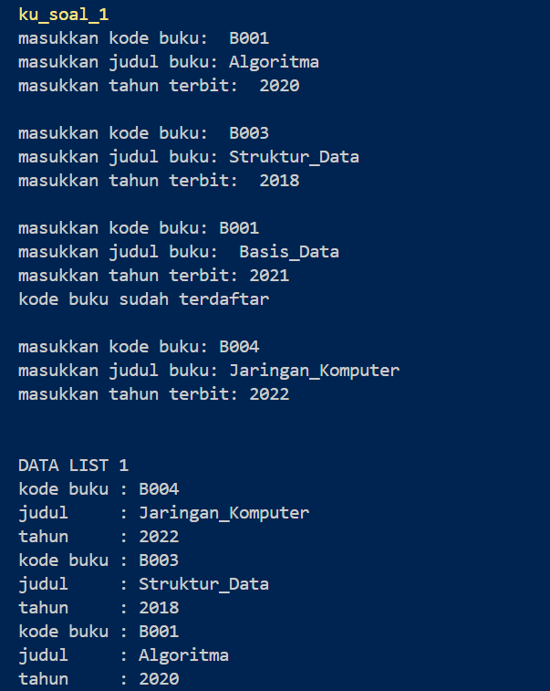
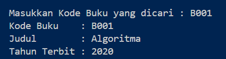
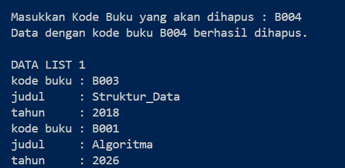

# <h1 align="center"> Modul 6 DOUBLY LINKED LIST (BAGIAN PERTAMA) </h1>
<p align="center">Muhammad Haidar Az Zacky - 109082530035</p>

## Dasar Teori

### A. Konsep Doubly Linked List

*Doubly linked list* adalah *linked list* yang setiap elemennya memiliki dua *successor*, yaitu pointer `prev` yang menunjuk elemen sebelumnya dan pointer `next` yang menunjuk elemen sesudahnya. Dengan dua arah pointer ini, list dapat ditelusuri maju maupun mundur, berbeda dengan singly linked list yang hanya bisa maju.

List ini dikelola oleh dua pointer utama, yaitu `First` (menunjuk elemen pertama) dan `Last` (menunjuk elemen terakhir). List dinyatakan kosong bila `L.First = Nil`. Pada elemen pertama `prev` bernilai `Nil`, dan pada elemen terakhir `next` bernilai `Nil`.

Komponen-komponen doubly linked list:

| Komponen | Keterangan |
|---|---|
| `First` | Pointer pada list yang menunjuk elemen pertama |
| `Last` | Pointer pada list yang menunjuk elemen terakhir |
| `next` | Pointer pada elemen yang menunjuk elemen sesudahnya |
| `prev` | Pointer pada elemen yang menunjuk elemen sebelumnya |

Kerangka deklarasi tipe pada modul:

```C++
typedef int infotype;
typedef struct elmlist *address;
struct elmlist {
    infotype info;
    address next;
    address prev;
};
struct list {
    address first, last;
};
```

Karena tiap elemen menyimpan satu pointer tambahan, doubly linked list memakai memori lebih besar dibanding singly linked list, dan setiap operasi insert atau delete harus memperbarui dua tautan (`next` dan `prev`) sekaligus. Sebagai gantinya, penghapusan elemen yang alamatnya sudah diketahui dapat dilakukan dalam O(1) karena elemen sebelumnya langsung dapat dicapai lewat `prev`, dan operasi di ujung list (`insertLast`, `deleteLast`) juga O(1) karena ada pointer `Last`.

### B. Operasi Insert

**1. Insert First.** Elemen baru dipasang di depan list dengan langkah: `P->next = L.first`, `(L.first)->prev = P`, lalu `L.first = P`. Jika list masih kosong, `First` dan `Last` langsung diarahkan ke `P`.

**2. Insert Last.** Elemen baru dipasang di belakang list dengan langkah: `P->prev = L.last`, `(L.last)->next = P`, lalu `L.last = P`. Berbeda dengan singly linked list, tidak perlu menelusuri list sampai akhir karena sudah ada pointer `Last`, sehingga kompleksitasnya O(1).

**3. Insert After.** Elemen baru `P` disisipkan setelah elemen `R` dengan langkah: `P->next = R->next`, `P->prev = R`, `(R->next)->prev = P`, lalu `R->next = P`. Urutan langkah penting agar tautan ke elemen sesudah `R` tidak hilang.

**4. Insert Before.** Merupakan kebalikan dari *insert after*. Perbedaannya hanya pada pencarian elemen acuannya.

### C. Operasi Delete

**1. Delete First.** `P = L.first`, `L.first = (L.first)->next`, `(L.first)->prev = Nil`, `P->next = Nil`. Bila hanya ada satu elemen, `First` dan `Last` dikembalikan menjadi `Nil`.

**2. Delete Last.** `P = L.last`, `L.last = (L.last)->prev`, `(L.last)->next = Nil`, `P->prev = Nil`. Bila hanya ada satu elemen, `First` dan `Last` dikembalikan menjadi `Nil`.

**3. Delete After.** Elemen `P` yang berada setelah `R` dilepas dengan langkah: `R->next = P->next`, `(P->next)->prev = R`, lalu `P->prev = Nil` dan `P->next = Nil`.

**4. Delete Before.** Merupakan kebalikan dari *delete after*, dengan perbedaan pada pencarian elemennya.

Setelah dilepas dari list, elemen dikembalikan ke pemanggil (`return P`) atau langsung dibebaskan memorinya dengan `dealokasi(P)`.

### D. Update, View, dan Searching

Proses pencarian, *update*, dan *view* pada doubly linked list pada dasarnya sama dengan singly linked list. Bedanya, doubly linked list lebih mudah untuk diakses karena iterasi dapat dilakukan maju (dari `First` memakai `next`) maupun mundur (dari `Last` memakai `prev`). Pada praktikum ini `printInfo` menelusuri list dari `Last` ke `First` sehingga data tampil dalam urutan terbalik dari urutan masukan. Pencarian `findElm` tetap berupa pencarian sekuensial dengan kompleksitas O(n), dan mengembalikan alamat elemen atau `Nil` bila tidak ditemukan.

## Guided

Pada bagian Guided, ADT Doubly Linked List dibuat untuk data **kendaraan** (`nopol`, `warna`, `thnBuat`). Programnya terdiri atas tiga file: `Doublylist.h`, `Doublylist.cpp`, dan `main.cpp`.

### 1. Program Doublylist.h

```C++
#ifndef DOUBLYLIST_H
#define DOUBLYLIST_H

#include <iostream>
#include <string>

#define Nil NULL

// Latihan 1
struct infotype {
    std::string nopol; 
    std::string warna; 
    int thnBuat;      
};
typedef struct elmlist *address;
struct elmlist {
    infotype info;  
    address next;   
    address prev;   
};
struct List {
    address First; 
    address Last;  
};


// Latihan 1
void CreateList(List &L);
address alokasi(infotype x);
void dealokasi(address &P);
void printInfo(List L);
void insertLast(List &L, address P);

// Latihan 2

address findElm(List L, std::string nopol);

// Latihan 3
void deleteFirst(List &L, address &P);
void deleteLast(List &L, address &P);
void deleteAfter(List &L, address Prec, address &P);
void deleteElm(List &L, std::string nopol, bool &status);

#endif
```
**Penjelasan:** *Header* ini adalah "kontrak" ADT doubly linked list untuk data kendaraan.
- `#ifndef DOUBLYLIST_H / #define DOUBLYLIST_H / #endif` adalah *header guard* agar file tidak terbaca dua kali dalam satu program. `#define Nil NULL` memberi nama `Nil` untuk pointer kosong sesuai istilah pada materi.
- `struct infotype` adalah data majemuk berisi `nopol` (string), `warna` (string), dan `thnBuat` (int).
- `typedef struct elmlist *address` membuat `address` menjadi alias pointer ke `elmlist`. `struct elmlist` adalah elemen list yang berisi `info` serta dua pointer, yaitu `next` (ke elemen sesudahnya) dan `prev` (ke elemen sebelumnya).
- `struct List` menyimpan dua pointer, `First` dan `Last`, sehingga akses ke kedua ujung list bisa dilakukan langsung.
- Prototipe dibagi tiga kelompok sesuai latihan: **Latihan 1** (`CreateList`, `alokasi`, `dealokasi`, `printInfo`, `insertLast`), **Latihan 2** (`findElm`), dan **Latihan 3** (`deleteFirst`, `deleteLast`, `deleteAfter`, `deleteElm`).

### 2. Program Doublylist.cpp

```C++
#include "Doublylist.h"

// Latihan 1
void CreateList(List &L) {
    L.First = Nil;
    L.Last = Nil;
}

address alokasi(infotype x) {
    address P = new elmlist;
    P->info = x;
    P->next = Nil;
    P->prev = Nil; 
    return P;
}

void dealokasi(address &P) {
    delete P;
}

void printInfo(List L) {
    address P = L.Last;
    if (P == Nil) {
        std::cout << "List kosong." << std::endl;
        return;
    }
    while (P != Nil) {
        std::cout << "no polisi : " << P->info.nopol << std::endl;   
        std::cout << "warna     : " << P->info.warna << std::endl;   
        std::cout << "tahun     : " << P->info.thnBuat << std::endl; 
        P = P->prev;
    }
}

void insertLast(List &L, address P) {
    if (L.First == Nil) { 
        L.First = P;
        L.Last = P;
    } else {
        P->prev = L.Last;         
        (L.Last)->next = P;     
        L.Last = P;               
    }
}

// Latihan 2
address findElm(List L, std::string nopol) {
    address P = L.First;
    while (P != Nil) {
        if (P->info.nopol == nopol) {
            return P;
        }
        P = P->next;
    }
    return Nil;
}

// Latihan 3
void deleteFirst(List &L, address &P) {
    if (L.First == Nil) return;

    P = L.First; 
    if (L.First == L.Last) { 
        L.First = Nil;
        L.Last = Nil;
    } else {
        L.First = P->next;     
        (L.First)->prev = Nil; 
        P->next = Nil;         
    }
}

void deleteLast(List &L, address &P) {
    if (L.First == Nil) return;

    P = L.Last; 
    if (L.First == L.Last) { 
        L.First = Nil;
        L.Last = Nil;
    } else {
        L.Last = P->prev;      
        (L.Last)->next = Nil; 
        P->prev = Nil;         
    }
}

void deleteAfter(List &L, address Prec, address &P) {
    if (Prec == Nil || Prec->next == Nil) return;

    P = Prec->next;
    if (P == L.Last) {
        deleteLast(L, P);
    } else {
        Prec->next = P->next;     
        (P->next)->prev = Prec; 
        P->next = Nil;            
        P->prev = Nil;           
    }
}

void deleteElm(List &L, std::string nopol, bool &status) {
    address P = findElm(L, nopol);
    status = false;

    if (P != Nil) {
        if (P == L.First) {
            deleteFirst(L, P);
        } else if (P == L.Last) {
            deleteLast(L, P);
        } else {
            address Prec = P->prev;
            deleteAfter(L, Prec, P);
        }
        dealokasi(P); 
        status = true;
    }
}
```
**Penjelasan:** File ini berisi realisasi seluruh primitif yang dideklarasikan di `Doublylist.h`.

*Latihan 1 (dasar list):*
- `CreateList` mengisi `First` dan `Last` dengan `Nil` sehingga terbentuk list kosong.
- `alokasi` membuat elemen baru dengan `new elmlist`, mengisi `info`, lalu mengatur `next` dan `prev` menjadi `Nil` supaya elemen baru belum terhubung ke mana pun. `dealokasi` mengembalikan memori elemen dengan `delete`.
- `printInfo` menelusuri list **mundur**, dimulai dari `Last` lalu `P = P->prev` sampai `Nil`. Karena itu data tampil dari yang terakhir dimasukkan ke yang pertama dimasukkan, sesuai contoh output soal. Bila list kosong, ditampilkan "List kosong.".
- `insertLast`: jika list kosong, `First` dan `Last` sama-sama menunjuk `P`. Jika tidak, `P->prev` diarahkan ke `Last`, `Last->next` diarahkan ke `P`, lalu `Last` dipindah ke `P`. Operasi ini O(1) karena tidak perlu menelusuri list.

*Latihan 2 (searching):*
- `findElm` menelusuri list maju dari `First` dengan `P = P->next`. Pada tiap elemen, `nopol` dibandingkan dengan yang dicari. Bila cocok, alamat elemen langsung dikembalikan, bila sampai `Nil` tidak ada yang cocok, dikembalikan `Nil`. Pencarian ini O(n).

*Latihan 3 (delete):*
- `deleteFirst` menyimpan elemen pertama di `P`. Bila list hanya berisi satu elemen (`First == Last`), keduanya dikembalikan menjadi `Nil`. Bila tidak, `First` maju ke elemen berikutnya, `prev`-nya diputus menjadi `Nil`, dan `P->next` diputus.
- `deleteLast` simetris dengan `deleteFirst`: `Last` mundur ke `P->prev`, `next`-nya diputus menjadi `Nil`, dan `P->prev` diputus. Operasi ini O(1) berkat pointer `prev`.
- `deleteAfter` melepas elemen setelah `Prec`. Bila elemen tersebut adalah `Last`, pekerjaan diserahkan ke `deleteLast` agar `Last` ikut diperbarui. Bila di tengah, `Prec->next` dihubungkan ke `P->next` dan `prev` dari elemen sesudah `P` dihubungkan balik ke `Prec`.
- `deleteElm` menggabungkan semuanya: elemen dicari dengan `findElm`, lalu dipilih cara menghapus sesuai posisinya (awal, akhir, atau tengah), kemudian memorinya dibebaskan dengan `dealokasi` dan `status` diset `true`. Bila tidak ditemukan, `status` tetap `false`.

### 3. Program main.cpp

```C++
#include <iostream>
#include "Doublylist.h"
using namespace std;

void inputData(List &L) {
    infotype data;
    address P;

    cout << "masukkan nomor polisi: "; cin >> data.nopol;
    cout << "masukkan warna kendaraan: "; cin >> data.warna;
    cout << "masukkan tahun kendaraan: "; cin >> data.thnBuat;
    if (findElm(L, data.nopol) == Nil) {
        P = alokasi(data); 
        insertLast(L, P);  
    } else {
        cout << "nomor polisi sudah terdaftar" << endl; 
    }
}

int main() {
    List L;
    CreateList(L); 
    address P;

    // Latihan 1
    inputData(L); 
    inputData(L); 
    inputData(L); 
    inputData(L); 

    cout << "\nDATA LIST 1" << endl; 
    printInfo(L); 

    // Latihan 2
    string nopolCari;
    cout << "\nMasukkan Nomor Polisi yang dicari : "; 
    cin >> nopolCari; 
    
    P = findElm(L, nopolCari); 
    if (P != Nil) {
        cout << "Nomor Polisi : " << P->info.nopol << endl; 
        cout << "Warna        : " << P->info.warna << endl; 
        cout << "Tahun        : " << P->info.thnBuat << endl; 
    } else {
        cout << "Data dengan nomor polisi " << nopolCari << " tidak ditemukan." << endl;
    }

    // Latihan 3
    string nopolHapus;
    bool hapusBerhasil;
    cout << "\nMasukkan Nomor Polisi yang akan dihapus : ";
    cin >> nopolHapus;

    deleteElm(L, nopolHapus, hapusBerhasil); 

    if (hapusBerhasil) {
        cout << "Data dengan nomor polisi " << nopolHapus << " berhasil dihapus." << endl; 
    } else {
        cout << "Data dengan nomor polisi " << nopolHapus << " tidak ditemukan." << endl;
    }
    cout << "\nDATA LIST 1" << endl; 
    printInfo(L); 

    return 0;
}
```
**Penjelasan:** Ini adalah *driver* yang memakai ADT.
- `inputData` membaca nomor polisi, warna, dan tahun dari keyboard. Sebelum disimpan, `findElm` dipanggil untuk memeriksa duplikasi. Bila nomor polisi belum ada, data dialokasikan dengan `alokasi` lalu dipasang di belakang list dengan `insertLast`. Bila sudah ada, ditampilkan "nomor polisi sudah terdaftar" dan data tidak disimpan.
- **Latihan 1:** `inputData` dipanggil empat kali, lalu `printInfo` menampilkan isi list. Contoh masukan `D001 hitam 90`, `D003 putih 70`, `D001 merah 80` (ditolak karena duplikat), dan `D004 kuning 90` menghasilkan tampilan D004, D003, D001 (urutan terbalik karena `printInfo` mulai dari `Last`).
- **Latihan 2:** program meminta nomor polisi yang dicari. Bila `findElm` mengembalikan alamat, data elemen ditampilkan. Untuk `D001` tampil warna hitam dan tahun 90.
- **Latihan 3:** program meminta nomor polisi yang akan dihapus lalu memanggil `deleteElm`. Untuk `D003` (elemen tengah) pesan "berhasil dihapus" tampil dan list tersisa D004 dan D001.
- Kompilasi harus menyertakan kedua file `.cpp`: `g++ main.cpp Doublylist.cpp -o program`. Nama file harus ditulis persis `Doublylist.h` karena `#include "Doublylist.h"` bersifat *case-sensitive* pada Linux.

## Unguided

Pada bagian Unguided, ADT Doubly Linked List dibuat untuk data **buku** (`kodeBuku`, `judul`, `thnTerbit`) dengan tiga file: `Buku.h`, `Buku.cpp`, dan `main.cpp`. Struktur programnya mirip dengan Guided, hanya tipe datanya yang berbeda. Setiap soal disimpan dalam folder sendiri (`soal_1`, `soal_2`, `soal_3`) dan **dapat dikompilasi sendiri-sendiri** dengan perintah `g++ main.cpp Buku.cpp -o nama_program`.

### 1. Pembuatan ADT Dasar dan Insert Data (Soal no. 1)

```C++
/* file : Buku.h */
#ifndef BUKU_H
#define BUKU_H

#include <iostream>
#include <string>

#define Nil NULL

struct infotype {
    std::string kodeBuku;
    std::string judul;
    int thnTerbit;
};

typedef struct ElmList *address;

struct ElmList {
    infotype info;
    address next;
    address prev;
};

struct List {
    address First;
    address Last;
};

void CreateList(List &L);
address alokasi(infotype x);
void dealokasi(address &P);
void printInfo(List L);
void insertLast(List &L, address P);
address findElm(List L, std::string kodeBuku);

#endif
```
```C++
/* file : Buku.cpp */
#include "Buku.h"
using namespace std;

void CreateList(List &L) {
    L.First = Nil;
    L.Last = Nil;
}

address alokasi(infotype x) {
    address P = new ElmList;
    P->info = x;
    P->next = Nil;
    P->prev = Nil;
    return P;
}

void dealokasi(address &P) {
    delete P;
    P = Nil;
}

void printInfo(List L) {
    address P = L.Last;
    while (P != Nil) {
        cout << "kode buku : " << P->info.kodeBuku << endl;
        cout << "judul     : " << P->info.judul << endl;
        cout << "tahun     : " << P->info.thnTerbit << endl;
        P = P->prev;
    }
}

void insertLast(List &L, address P) {
    if (L.First == Nil) {
        L.First = P;
        L.Last = P;
    } else {
        P->prev = L.Last;
        L.Last->next = P;
        L.Last = P;
    }
}

address findElm(List L, string kodeBuku) {
    address P = L.First;
    while (P != Nil) {
        if (P->info.kodeBuku == kodeBuku) {
            return P;
        }
        P = P->next;
    }
    return Nil;
}
```
```C++
/* file : main.cpp */
#include <iostream>
#include "Buku.h"
using namespace std;

void inputData(List &L) {
    infotype data;
    cout << "masukkan kode buku: ";
    cin >> data.kodeBuku;
    cout << "masukkan judul buku: ";
    cin >> data.judul;
    cout << "masukkan tahun terbit: ";
    cin >> data.thnTerbit;

    if (findElm(L, data.kodeBuku) == Nil) {
        address P = alokasi(data);
        insertLast(L, P);
    } else {
        cout << "kode buku sudah terdaftar" << endl;
    }

    cout << endl;
}

int main() {
    List L;
    CreateList(L);

    inputData(L);
    inputData(L);
    inputData(L);
    inputData(L);

    cout << "\nDATA LIST 1" << endl;
    printInfo(L);

    return 0;
}
```
### Output Unguided 1 :

##### Output 1


**Penjelasan:**
- `Buku.h` ditulis mengikuti spesifikasi soal: `infotype` berisi `kodeBuku`, `judul`, dan `thnTerbit`; `address` berupa pointer ke `ElmList`; `ElmList` berisi `info`, `next`, dan `prev`; `List` berisi `First` dan `Last`. Lima primitif yang diminta (`CreateList`, `alokasi`, `dealokasi`, `printInfo`, `insertLast`) direalisasikan di `Buku.cpp`.
- `CreateList` mengisi `First` dan `Last` dengan `Nil`. `alokasi` membuat elemen baru dengan `new` dan mengatur `next` serta `prev` menjadi `Nil`. `dealokasi` membebaskan memori dengan `delete` lalu mengembalikan `P` ke `Nil`.
- `insertLast` menangani dua kasus. Bila list kosong, `First` dan `Last` diarahkan ke `P`. Bila tidak, `P->prev` diarahkan ke `Last`, `Last->next` diarahkan ke `P`, lalu `Last` dipindah ke `P`. Operasi ini O(1) karena tidak perlu menelusuri list.
- `printInfo` menelusuri list dari `Last` mundur dengan `P = P->prev`, sehingga data tampil dari yang terakhir dimasukkan (B004, B003, B001), sama dengan contoh output soal.
- Soal meminta pengecekan duplikasi `kodeBuku` sebelum data dimasukkan. Pengecekan ini memakai fungsi `findElm`, sehingga `findElm` sudah ditulis di `Buku.h` dan `Buku.cpp` sejak soal no. 1 (cara kerjanya dijelaskan pada soal no. 2).
- Pada `inputData`, `findElm` dipanggil **sebelum** `alokasi`. Jika kode belum ada, data dialokasikan lalu dipasang dengan `insertLast`. Jika sudah ada, tampil "kode buku sudah terdaftar" dan data tidak disimpan. Pada contoh, `B001` yang dimasukkan kedua kali ditolak.
- Judul dibaca dengan `cin >>` sehingga harus satu kata, itulah sebabnya contoh memakai `Struktur_Data` dengan garis bawah.
- Kompilasi: `g++ main.cpp Buku.cpp -o buku_soal_1`.

### 2. Pencarian Elemen (Soal no. 2)

Soal ini melanjutkan soal no. 1. `Buku.h` dan `Buku.cpp` sama dengan soal no. 1 karena fungsi `findElm( L : List, x : infotype ) : address` sudah tersedia di sana. Yang berubah hanya `main.cpp`, yaitu ditambah bagian pencarian kode buku. Pada implementasi ini parameter pencarian berupa `kodeBuku` (string) karena itulah kunci unik buku.

```C++
/* file : Buku.h */
#ifndef BUKU_H
#define BUKU_H

#include <iostream>
#include <string>

#define Nil NULL

struct infotype {
    std::string kodeBuku;
    std::string judul;
    int thnTerbit;
};

typedef struct ElmList *address;

struct ElmList {
    infotype info;
    address next;
    address prev;
};

struct List {
    address First;
    address Last;
};

void CreateList(List &L);
address alokasi(infotype x);
void dealokasi(address &P);
void printInfo(List L);
void insertLast(List &L, address P);
address findElm(List L, std::string kodeBuku);

#endif
```
```C++
/* file : Buku.cpp */
#include "Buku.h"
using namespace std;

void CreateList(List &L) {
    L.First = Nil;
    L.Last = Nil;
}

address alokasi(infotype x) {
    address P = new ElmList;
    P->info = x;
    P->next = Nil;
    P->prev = Nil;
    return P;
}

void dealokasi(address &P) {
    delete P;
    P = Nil;
}

void printInfo(List L) {
    address P = L.Last;
    while (P != Nil) {
        cout << "kode buku : " << P->info.kodeBuku << endl;
        cout << "judul     : " << P->info.judul << endl;
        cout << "tahun     : " << P->info.thnTerbit << endl;
        P = P->prev;
    }
}

void insertLast(List &L, address P) {
    if (L.First == Nil) {
        L.First = P;
        L.Last = P;
    } else {
        P->prev = L.Last;
        L.Last->next = P;
        L.Last = P;
    }
}

address findElm(List L, string kodeBuku) {
    address P = L.First;
    while (P != Nil) {
        if (P->info.kodeBuku == kodeBuku) {
            return P;
        }
        P = P->next;
    }
    return Nil;
}
```
```C++
/* file : main.cpp */
#include <iostream>
#include "Buku.h"
using namespace std;

void inputData(List &L) {
    infotype data;
    cout << "masukkan kode buku: ";
    cin >> data.kodeBuku;
    cout << "masukkan judul buku: ";
    cin >> data.judul;
    cout << "masukkan tahun terbit: ";
    cin >> data.thnTerbit;

    if (findElm(L, data.kodeBuku) == Nil) {
        address P = alokasi(data);
        insertLast(L, P);
    } else {
        cout << "kode buku sudah terdaftar" << endl;
    }

    cout << endl;
}

int main() {
    List L;
    CreateList(L);

    inputData(L);
    inputData(L);
    inputData(L);
    inputData(L);

    cout << "\nDATA LIST 1" << endl;
    printInfo(L);

    // Soal 2: pencarian
    string kodeCari;
    cout << "\nMasukkan Kode Buku yang dicari : ";
    cin >> kodeCari;

    address P = findElm(L, kodeCari);
    if (P != Nil) {
        cout << "Kode Buku    : " << P->info.kodeBuku << endl;
        cout << "Judul        : " << P->info.judul << endl;
        cout << "Tahun Terbit : " << P->info.thnTerbit << endl;
    } else {
        cout << "Buku dengan kode " << kodeCari << " tidak ditemukan." << endl;
    }

    return 0;
}
```
### Output Unguided 2 :

##### Output 2


**Penjelasan:**
- `findElm` menelusuri list dari `First` dengan `P = P->next`. Setiap `kodeBuku` dibandingkan dengan yang dicari. Bila sama, alamat elemen langsung dikembalikan. Bila sampai `Nil` tidak ada yang cocok, dikembalikan `Nil`.
- Fungsi ini mengembalikan **alamat** elemen (bukan sekadar benar/salah), sehingga hasilnya langsung bisa dipakai untuk menampilkan data atau untuk operasi lanjutan seperti penghapusan.
- Pada `main.cpp`, kode yang dicari dibaca ke `kodeCari`, lalu hasil `findElm` disimpan di `P`. Jika `P != Nil`, kode, judul, dan tahun terbit ditampilkan. Jika `Nil`, tampil pesan tidak ditemukan.
- Pada contoh, pencarian `B001` menampilkan judul Algoritma dan tahun terbit 2020. Pencarian kode yang tidak ada (misalnya `B999`) menampilkan pesan tidak ditemukan.
- Kompleksitas pencarian O(1) pada kasus terbaik (data di elemen pertama) dan O(n) pada kasus terburuk (data di elemen terakhir atau tidak ada).
- Kompilasi: `g++ main.cpp Buku.cpp -o buku_soal_2`.

### 3. Penghapusan Elemen / Delete (Soal no. 3)

Soal ini melanjutkan soal no. 1 dan 2. Pada `Buku.h` ditambahkan empat prototipe, yaitu `deleteFirst`, `deleteLast`, `deleteAfter` (sesuai soal), dan `deleteByKode` sebagai pembungkus agar `main.cpp` cukup memanggil satu fungsi. Di `Buku.cpp` ditambahkan realisasinya, dan `main.cpp` ditambah bagian penghapusan.

```C++
/* file : Buku.h */
#ifndef BUKU_H
#define BUKU_H

#include <iostream>
#include <string>

#define Nil NULL

struct infotype {
    std::string kodeBuku;
    std::string judul;
    int thnTerbit;
};

typedef struct ElmList *address;

struct ElmList {
    infotype info;
    address next;
    address prev;
};

struct List {
    address First;
    address Last;
};

void CreateList(List &L);
address alokasi(infotype x);
void dealokasi(address &P);
void printInfo(List L);
void insertLast(List &L, address P);
address findElm(List L, std::string kodeBuku);

void deleteFirst(List &L, address &P);
void deleteLast(List &L, address &P);
void deleteAfter(address Prec, address &P);
bool deleteByKode(List &L, std::string kodeBuku);

#endif
```
```C++
/* file : Buku.cpp */
void deleteFirst(List &L, address &P) {
    P = L.First;
    if (L.First == L.Last) {
        L.First = Nil;
        L.Last = Nil;
    } else {
        L.First = P->next;
        L.First->prev = Nil;
        P->next = Nil;
    }
}

void deleteLast(List &L, address &P) {
    P = L.Last;
    if (L.First == L.Last) {
        L.First = Nil;
        L.Last = Nil;
    } else {
        L.Last = P->prev;
        L.Last->next = Nil;
        P->prev = Nil;
    }
}

void deleteAfter(address Prec, address &P) {
    P = Prec->next;
    Prec->next = P->next;
    P->next->prev = Prec;
    P->next = Nil;
    P->prev = Nil;
}

// Mencari buku, lalu menghapusnya sesuai posisinya
bool deleteByKode(List &L, string kodeBuku) {
    address P = findElm(L, kodeBuku);
    if (P == Nil) {
        return false;
    }

    if (P == L.First) {
        deleteFirst(L, P);
    } else if (P == L.Last) {
        deleteLast(L, P);
    } else {
        deleteAfter(P->prev, P);
    }
    dealokasi(P);
    return true;
}
```
```C++
/* file : main.cpp */
#include <iostream>
#include "Buku.h"
using namespace std;

void inputData(List &L) {
    infotype data;
    cout << "masukkan kode buku: ";
    cin >> data.kodeBuku;
    cout << "masukkan judul buku: ";
    cin >> data.judul;
    cout << "masukkan tahun terbit: ";
    cin >> data.thnTerbit;

    if (findElm(L, data.kodeBuku) == Nil) {
        address P = alokasi(data);
        insertLast(L, P);
    } else {
        cout << "kode buku sudah terdaftar" << endl;
    }

    cout << endl;
}

int main() {
    List L;
    CreateList(L);

    inputData(L);
    inputData(L);
    inputData(L);
    inputData(L);

    cout << "\nDATA LIST 1" << endl;
    printInfo(L);

    // Soal 2: pencarian
    string kodeCari;
    cout << "\nMasukkan Kode Buku yang dicari : ";
    cin >> kodeCari;

    address P = findElm(L, kodeCari);
    if (P != Nil) {
        cout << "Kode Buku    : " << P->info.kodeBuku << endl;
        cout << "Judul        : " << P->info.judul << endl;
        cout << "Tahun Terbit : " << P->info.thnTerbit << endl;
    } else {
        cout << "Buku dengan kode " << kodeCari << " tidak ditemukan." << endl;
    }

    // Soal 3: penghapusan
    string kodeHapus;
    cout << "\nMasukkan Kode Buku yang akan dihapus : ";
    cin >> kodeHapus;

    if (deleteByKode(L, kodeHapus)) {
        cout << "Data dengan kode buku " << kodeHapus << " berhasil dihapus." << endl;
    } else {
        cout << "Data dengan kode buku " << kodeHapus << " tidak ditemukan." << endl;
    }

    cout << "\nDATA LIST 1" << endl;
    printInfo(L);

    return 0;
}
```
### Output Unguided 3 :

##### Output 3


**Penjelasan:**
- `deleteFirst` menyimpan elemen pertama di `P`. Bila list hanya berisi satu elemen (`First == Last`), `First` dan `Last` dikembalikan ke `Nil`. Bila lebih, `First` maju ke elemen berikutnya, `prev`-nya diputus menjadi `Nil`, dan `P->next` diputus agar `P` benar-benar terlepas dari list.
- `deleteLast` bekerja simetris. `Last` mundur ke `P->prev`, `next`-nya diputus menjadi `Nil`, dan `P->prev` diputus. Pada singly linked list operasi ini harus menelusuri seluruh list (O(n)), sedangkan di sini cukup O(1) berkat pointer `prev`.
- `deleteAfter(Prec, P)` mengikuti spesifikasi soal, yaitu hanya menerima `Prec` dan `P`. Prosedur ini dipakai untuk elemen di **tengah** list sehingga `First` dan `Last` tidak berubah. Langkahnya: `Prec->next = P->next`, `P->next->prev = Prec`, lalu `P->next` dan `P->prev` diputus.
- `deleteByKode` mencari elemen dengan `findElm`, lalu memilih prosedur sesuai posisinya: `deleteFirst` bila di awal, `deleteLast` bila di akhir, dan `deleteAfter` bila di tengah. `Prec` untuk kasus tengah diperoleh langsung dari `P->prev`, ini keuntungan doubly linked list dibanding singly linked list yang harus mencari `Prec` dari awal list. Setelah elemen terlepas, memori dibebaskan dengan `dealokasi(P)`. Fungsi mengembalikan `true` bila berhasil dan `false` bila kode tidak ditemukan.
- Pada contoh, `B003` berada di tengah list (B001, B003, B004), sehingga dihapus lewat `deleteAfter`. Hasil akhir saat dicetak mundur adalah B004 lalu B001, sama dengan contoh output soal. Menghapus `B001` melewati `deleteFirst`, dan menghapus `B004` melewati `deleteLast`. Ketiga jalur ini, serta kasus kode tidak ditemukan dan list berisi satu elemen, sudah diuji.
- Kompilasi: `g++ main.cpp Buku.cpp -o buku_soal_3`.

## Kesimpulan

**Kesimpulan modul.** Modul ini memperkenalkan doubly linked list, yaitu linked list yang setiap elemennya memiliki pointer `next` dan `prev`, serta list yang dikelola oleh pointer `First` dan `Last`. Dua arah pointer memungkinkan penelusuran maju dan mundur, penyisipan dan penghapusan di ujung list dalam waktu konstan, serta penghapusan elemen tanpa harus mencari elemen sebelumnya dari awal list. Harganya adalah pemakaian memori yang lebih besar dan pengelolaan dua tautan pada setiap operasi, sehingga urutan penulisan pointer harus diperhatikan agar tidak ada tautan yang terputus. Seluruh operasi dibungkus dalam ADT yang dipisah menjadi header (`.h`), implementasi (`.cpp`), dan driver (`main.cpp`).

**Kesimpulan Guided.** Pada bagian Guided, ADT doubly linked list dengan data kendaraan (nomor polisi, warna, tahun) dipakai untuk mempraktikkan `insertLast` dengan pengecekan duplikasi, pencarian dengan `findElm`, dan penghapusan dengan `deleteFirst`, `deleteLast`, `deleteAfter`, serta `deleteElm`. Program memperlihatkan bahwa `insertLast` cukup O(1) karena ada pointer `Last`, bahwa `printInfo` dapat menelusuri list dari belakang sehingga data tampil terbalik dari urutan masukan, dan bahwa penghapusan harus menangani tiga kasus (awal, tengah, akhir) serta kasus khusus list berisi satu elemen agar `First` dan `Last` tetap konsisten.

**Kesimpulan Unguided.** Pada bagian Unguided, ADT yang sama diterapkan pada data buku (kode buku, judul, tahun terbit). Soal no. 1 membangun ADT dasar dengan pengecekan duplikasi `kodeBuku` memakai `findElm` sebelum data dialokasikan, sehingga tidak ada elemen ganda dan tidak ada memori yang terbuang. Soal no. 2 memakai `findElm` yang mengembalikan alamat elemen untuk mencari buku dengan kode B001. Soal no. 3 menambahkan `deleteFirst`, `deleteLast`, dan `deleteAfter` untuk menghapus buku B003, yang berada di tengah list, sehingga hasil akhir list adalah B004 lalu B001. Karena struktur Guided dan Unguided sama, perbedaan antara keduanya hanya pada tipe data dan kunci pencarian, sedangkan logika pointer-nya identik.

**Kesimpulan keseluruhan.** Secara keseluruhan, modul ini menunjukkan bahwa kunci dari doubly linked list adalah menjaga konsistensi dua pointer pada setiap perubahan struktur: `next` dan `prev` elemen yang terdampak, serta `First` dan `Last` pada kasus list kosong, satu elemen, dan elemen di ujung. Dibanding singly linked list, doubly linked list unggul pada operasi di ujung list dan penghapusan elemen yang alamatnya sudah diketahui, tetapi membutuhkan memori lebih besar dan kode yang lebih teliti. Pemisahan ADT ke dalam header, implementasi, dan driver membuat primitif seperti `findElm` dan `deleteAfter` mudah dipakai ulang. Pemahaman ini menjadi bekal untuk mempelajari bagian kedua doubly linked list, circular linked list, serta stack dan queue.

## Referensi

[1] Cormen, T. H., Leiserson, C. E., Rivest, R. L., & Stein, C. (2022). *Introduction to Algorithms* (4th ed.). Cambridge, MA: MIT Press. (Bab 10: Elementary Data Structures, subbab Linked Lists, termasuk pembahasan *doubly linked list*).
<br>[2] Knuth, D. E. (1997). *The Art of Computer Programming, Volume 1: Fundamental Algorithms* (3rd ed.). Boston: Addison-Wesley. (Bab 2: Information Structures, subbab 2.2.5 Doubly Linked Lists).
<br>[3] Weiss, M. A. (2014). *Data Structures and Algorithm Analysis in C++* (4th ed.). Boston: Pearson. (Bab 3: Lists, Stacks, and Queues).
<br>[4] Shafiei, N. (2016). Non-Blocking Doubly-Linked Lists with Good Amortized Complexity. *19th International Conference on Principles of Distributed Systems (OPODIS 2015)*, LIPIcs vol. 46, 35:1-35:17. Dagstuhl: Schloss Dagstuhl - Leibniz-Zentrum fur Informatik. https://doi.org/10.4230/LIPIcs.OPODIS.2015.35
<br>[5] Saketang, T. R. Y., Pandiangan, G. R., Matondang, F. A., & Situmorang, R. I. (2025). Implementasi Struktur Data Stack pada Sistem Recently Played Music Streaming Berbasis Prinsip LIFO. *Jurnal Penelitian Ilmiah Multidisipliner (JPIM)*, 2(3), 1192-1197. ISSN 3089-0128. https://ojs.ruangpublikasi.com/index.php/jpim/article/download/1011/842/3224
<br>[6] Sonntag, B., & Colnet, D. (2023). *RIP Linked List: Empirical Study to Discourage You from Using Linked Lists Any Further*. arXiv:2306.06942. https://arxiv.org/abs/2306.06942
